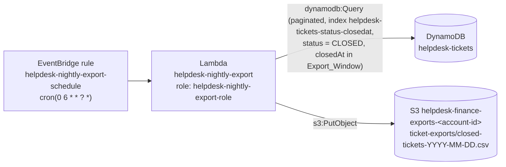
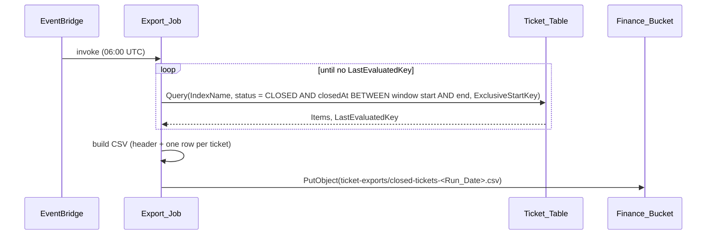

# Design Document

## Overview

A scheduled Lambda function, `helpdesk-nightly-export`, queries the `helpdesk-tickets` table once a day for the tickets whose status is `CLOSED` and whose `closedAt` falls within the Export_Window (the previous UTC day), writes them as an RFC 4180 CSV, and uploads the file to `ticket-exports/closed-tickets-<Run_Date>.csv` in the Finance bucket. An EventBridge rule starts it at `cron(0 6 * * ? *)`. The function runs under its own role, which can query one index of the one table and put objects under the one prefix.

The design is deliberately small: one handler module, one CDK construct, one rule, and one global secondary index on the table. It does not touch `src/api/`.

### Decisions

| Decision | Choice | Why |
|---|---|---|
| Reading the table | `Query` on the GSI `helpdesk-tickets-status-closedat` (partition key `status`, sort key `closedAt`), with key condition `status = CLOSED AND closedAt BETWEEN <window start> AND <window end>`, following `LastEvaluatedKey` | Requirement 2 selects by `closedAt`, so the read should be driven by `closedAt`. `closedAt` is written only by the close endpoint, so it is the trustworthy timestamp. Timestamps are ISO 8601 UTC strings with second precision, so `BETWEEN` on the strings is a time range and the inclusive bounds match the Export_Window. A Query reads only the matching items. There is no `Scan` code path. |
| Index design | New GSI `helpdesk-tickets-status-closedat`: partition key `status` (S), sort key `closedAt` (S), projection `INCLUDE` of `requester`, `priority`, `createdAt` | Both key attributes already exist on tickets, so no change to `src/api/` and no backfill code is needed. Tickets with no `closedAt` (open or in progress) are not written to the index. The table key schema is unchanged. Projected attributes cover every export column (`ticketId`, `status` and `closedAt` are always projected), so the Query needs no fetch from the base table. All closed tickets share one index partition value. That is acceptable at this volume (the service is small and the job reads one day's slice by sort key); a per-month or per-day partition value would need a new attribute written by `src/api/` and is not warranted. |
| Export_Window | Derived from the Run_Date: start `<Run_Date - 1 day>T00:00:00Z`, end `<Run_Date - 1 day>T23:59:59Z` | Matches the glossary. Both bounds are inclusive in `BETWEEN`, and with second precision no ticket can fall between 23:59:59 and the next 00:00:00. |
| Writing the file | `s3.put_object` with the whole CSV as the body | `PutObject` overwrites an existing key, which satisfies 4.2 with no extra code. |
| Schedule | `cron(0 6 * * ? *)` (UTC) | A fixed UTC time is 01:00 EST and 02:00 EDT, so it is always before the 3 AM Eastern job (Req 1.2). No timezone handling is needed. |
| Run_Date | UTC date from the clock at invocation | Matches the "UTC date on which the job runs" definition. It names the S3 key (Req 4.1) and is the base for the Export_Window. The file is dated by the day it runs, not by the day it covers. |
| CSV | `csv` module from the standard library, `lineterminator="\r\n"`, default minimal quoting | This is RFC 4180 compliant: CRLF line ends, fields with commas, quotes or line breaks are quoted, and quotes are doubled. |
| Bucket and table location | Environment variables `TABLE_NAME` and `BUCKET_NAME` | Same pattern as the API handlers (`TABLE_NAME`). |

### Findings from reading the existing code

- `app.py` already passes `finance.bucket_name` (a string, `helpdesk-finance-exports-<account>`) into `HelpdeskApiStack` as `finance_bucket_name`. The stack currently only emits it as an output. The new construct receives this string and builds the object ARN from it. Because it is a string and not a bucket object, CDK adds no cross-stack dependency. That is fine: the bucket is only used at run time, not at deploy time. The only effect is that nothing forces the Finance stack to deploy first, so the bucket must already exist before the first scheduled run.
- `HelpdeskApiStack` exposes `self.table`, so the construct can take the table ARN from it. The GSI is added to that table in `helpdesk_stack.py` with `add_global_secondary_index`, which is the one change outside the new construct file. The table is on-demand, so the index needs no capacity settings. CloudFormation backfills the index for existing closed tickets when the stack updates.
- `FakeTable` in `tests/conftest.py` has no `query` that understands an index and a `BETWEEN` key condition, and there is no S3 fake. Both must be added (see Testing Strategy). The additions are additive and do not change existing behavior.
- `common.py` and `ticket_store.py` live under `src/api/`. The export package does not import from them, to keep the packages independent and leave `src/api/` unchanged. The small amount of duplicated logic (a UTC date, a `get_table` helper) is cheaper than coupling.

### Confirmed decisions

1. **Logging permission kept (extension of Requirement 5.1).** 5.1 limits the role to reading the table and writing under the prefix. Without permission to write to CloudWatch Logs, a failed run would leave no trace, and Finance could not tell an empty day from a failed run except by a missing file. The design therefore keeps one extra statement scoped to the function's own log group (`logs:CreateLogStream`, `logs:PutLogEvents`). This is a small, deliberate extension of Requirement 5.1, confirmed by the user.

### Points to confirm

2. **Requirement 3.1 wording.** "A header row followed by the columns ..." is read as: a header row whose cells are the column names, then one data row per ticket with values in the same order.
3. **A CLOSED ticket with a missing attribute** (for example no `closedAt`) is written with an empty cell rather than failing the run. The product notes say `closedAt` is set by the close endpoint, so this should not occur, but the export should not fail on it.

## Architecture



Sequence for one run:



## Components and Interfaces

### Handler module: `src/export/nightly_export.py`

Lambda handler string: `export.nightly_export.handler`. The package also needs `src/export/__init__.py`.

```python
COLUMNS = ("ticketId", "requester", "priority", "createdAt", "closedAt")
EXPORT_PREFIX = "ticket-exports/"

def handler(event, context) -> dict:
    """Entry point. Wires real boto3 clients and calls run_export."""

INDEX_NAME = "helpdesk-tickets-status-closedat"

def run_export(table, s3, bucket: str, run_date: str) -> dict:
    """Query, build, upload. Returns {"key": ..., "count": n}."""

def export_window(run_date: str) -> tuple[str, str]:
    """(start, end) of the UTC day before run_date, e.g.
    ('2026-11-10T00:00:00Z', '2026-11-10T23:59:59Z') for '2026-11-11'."""

def query_closed_tickets(table, window_start: str, window_end: str) -> list[dict]:
    """All CLOSED tickets with closedAt in [window_start, window_end],
    following LastEvaluatedKey."""

def build_csv(tickets: list[dict]) -> str:
    """Header row plus one row per ticket, in COLUMNS order, RFC 4180."""

def export_key(run_date: str) -> str:
    """'ticket-exports/closed-tickets-<run_date>.csv'"""

def utc_run_date() -> str:
    """Today's UTC date as YYYY-MM-DD."""
```

`run_export` takes the table and S3 client as arguments so tests pass fakes and never import AWS. `handler` is the only place that calls `boto3`, and it imports `boto3` inside the function, as `api/common.py` does.

Query call (`status` is a DynamoDB reserved word, so it uses a name placeholder):

```python
kwargs = {
    "IndexName": INDEX_NAME,
    "KeyConditionExpression": "#s = :closed AND #c BETWEEN :start AND :end",
    "ExpressionAttributeNames": {"#s": "status", "#c": "closedAt"},
    "ExpressionAttributeValues": {
        ":closed": "CLOSED",
        ":start": window_start,
        ":end": window_end,
    },
}
while True:
    page = table.query(**kwargs)
    items.extend(page.get("Items", []))
    if "LastEvaluatedKey" not in page:
        break
    kwargs["ExclusiveStartKey"] = page["LastEvaluatedKey"]
```

There is no filter expression, so every item read is returned. A Query still stops at 1 MB per page, so the loop follows `LastEvaluatedKey` until it is absent.

Upload call:

```python
s3.put_object(
    Bucket=bucket,
    Key=export_key(run_date),
    Body=body.encode("utf-8"),
    ContentType="text/csv; charset=utf-8",
)
```

Row building: `row = [str(ticket.get(c, "")) for c in COLUMNS]`. Values are strings in the table (ids, names, priority, ISO timestamps), so no number or Decimal handling is needed.

### CDK construct: `infra/nightly_export.py`

```python
class NightlyExport(Construct):
    def __init__(self, scope, construct_id, *, table: dynamodb.ITable,
                 finance_bucket_name: str) -> None: ...
```

Instantiated from `HelpdeskApiStack` after the table is created:

```python
NightlyExport(self, "NightlyExport", table=self.table,
              finance_bucket_name=finance_bucket_name)
```

Resources it creates:

| Resource | Setting |
|---|---|
| `iam.Role` | `role_name="helpdesk-nightly-export-role"`, assumed by `lambda.amazonaws.com` |
| Inline policy statement 1 | `dynamodb:Query` on the index ARN only: `<table.table_arn>/index/helpdesk-tickets-status-closedat`. No permission on the table ARN itself. |
| Inline policy statement 2 | `s3:PutObject` on `arn:aws:s3:::<finance_bucket_name>/ticket-exports/*` |
| Inline policy statement 3 (see confirmed decision 1) | `logs:CreateLogStream`, `logs:PutLogEvents` on the ARN of the function's log group |
| `logs.LogGroup` | `log_group_name="/aws/lambda/helpdesk-nightly-export"`, `retention=logs.RetentionDays.ONE_MONTH` (30 days), passed to the function so the ARN in statement 3 is known |
| `lambda_.Function` | `function_name="helpdesk-nightly-export"`, `PYTHON_3_12`, `handler="export.nightly_export.handler"`, `code=Code.from_asset("src")`, `role=` the role above, env `TABLE_NAME`, `INDEX_NAME` and `BUCKET_NAME`, timeout 120 s, memory 256 MB |
| `events.Rule` | `rule_name="helpdesk-nightly-export-schedule"`, `schedule=events.Schedule.cron(minute="0", hour="6")`, target `targets.LambdaFunction(fn)` |

`Schedule.cron(minute="0", hour="6")` synthesizes to `cron(0 6 * * ? *)`; this is in UTC, as EventBridge always is.

The index is added in `helpdesk_stack.py`, right after the table is created:

```python
self.table.add_global_secondary_index(
    index_name="helpdesk-tickets-status-closedat",
    partition_key=dynamodb.Attribute(name="status", type=dynamodb.AttributeType.STRING),
    sort_key=dynamodb.Attribute(name="closedAt", type=dynamodb.AttributeType.STRING),
    projection_type=dynamodb.ProjectionType.INCLUDE,
    non_key_attributes=["requester", "priority", "createdAt"],
)
```

The construct takes the index name from a shared constant so the policy, the environment variable `INDEX_NAME`, and the table definition cannot drift apart.

The role is built explicitly rather than with `table.grant_read_data`, because the grant helper also gives `GetItem`, `Scan`, `BatchGetItem` and table-wide permissions that the job does not use. The role has no managed policies, so `AWSLambdaBasicExecutionRole` (which grants logs on `*`) is not attached.

Because the role has no `s3:ListBucket`, nothing can enumerate the bucket. `PutObject` does not need it.

## Data Models

Input: a ticket item from `helpdesk-tickets` (existing shape, unchanged), read through the index `helpdesk-tickets-status-closedat`. Only these attributes are read:

| Attribute | Type | Notes |
|---|---|---|
| `ticketId` | string | partition key of the table; projected into the index automatically |
| `status` | string | `OPEN`, `IN_PROGRESS`, or `CLOSED`; index partition key |
| `requester` | string | free text, may contain commas, quotes, line breaks |
| `priority` | string | `P1` to `P4` |
| `createdAt` | string | ISO 8601 UTC, `Z` suffix |
| `closedAt` | string | ISO 8601 UTC; set only by the close endpoint; index sort key |

Window for the example Run_Date `2026-11-11`: `2026-11-10T00:00:00Z` to `2026-11-10T23:59:59Z`, written to `ticket-exports/closed-tickets-2026-11-11.csv`.

Output: the Export_File.

```
ticketId,requester,priority,createdAt,closedAt\r\n
T-0002,Grace Hopper,P1,2026-11-09T10:00:00Z,2026-11-10T15:30:00Z\r\n
```

- Encoding: UTF-8, no BOM.
- Line terminator: CRLF, including after the last row.
- A fields containing `,`, `"`, `CR` or `LF` is wrapped in double quotes and embedded quotes are doubled.
- Empty day: the header line only.
- Row order: ascending `closedAt`, as returned by the index. Finance's report is not specified to need an order.

Destination key: `ticket-exports/closed-tickets-YYYY-MM-DD.csv` in `helpdesk-finance-exports-<account-id>`.

## Correctness Properties

*A property is a characteristic or behavior that should hold true across all valid executions of a system-essentially, a formal statement about what the system should do. Properties serve as the bridge between human-readable specifications and machine-verifiable correctness guarantees.*

Reflection: the file-contents criteria (3.1, 3.2) and the empty-day criterion (6.1) are all checked by one round trip through a CSV parser, so they are one property. Selection (2.1, 2.2) depends on the window and on query pagination and is separate. The destination (4.1) is separate, and it is independent of the window: the key uses the Run_Date, the window uses the day before. Schedule, names and IAM (1.x, 5.x) are infrastructure and are checked with template assertions, not properties. Overwrite (4.2) is an example test.

### Property 1: Export contains exactly the tickets closed in the Export_Window

*For any* set of tickets with any mix of statuses and `closedAt` values, *for any* Run_Date, and *for any* query page size, the ticketIds in the rows of the Export_File are exactly the ticketIds of the tickets whose status is `CLOSED` and whose `closedAt` is between 00:00:00 and 23:59:59 UTC of the day before the Run_Date, inclusive, each appearing once. Tickets closed at the boundaries (`...T00:00:00Z` and `...T23:59:59Z` of the window day) are included. Tickets closed one second before or after the window, or on the Run_Date itself, are excluded.

**Validates: Requirements 2.1, 2.2**

### Property 2: CSV round trip with header

*For any* list of tickets (including the empty list and tickets whose text fields contain commas, double quotes, and line breaks), parsing the output of `build_csv` with an RFC 4180 reader yields a first row equal to `[ticketId, requester, priority, createdAt, closedAt]` followed by one row per ticket whose cells equal that ticket's values in that order. When the list is empty, the parsed result is the header row only.

**Validates: Requirements 3.1, 3.2, 6.1**

### Property 3: Destination key follows the Run_Date

*For any* valid calendar date used as the Run_Date and any ticket set, `run_export` makes exactly one `put_object` call, to the configured bucket, with key `ticket-exports/closed-tickets-<Run_Date>.csv` (not the Export_Window date), and the key starts with `ticket-exports/`.

**Validates: Requirements 4.1**

## Error Handling

- **Query or upload fails** (throttling, permission, missing bucket or index): the exception is not caught. The invocation fails, Lambda logs the error, and EventBridge's asynchronous invoke retries up to two more times by default. Swallowing the error would hide a failed export, which is the case Req 6 is meant to let Finance tell apart.
- **Partial results are never uploaded.** The CSV is built only after the query loop completes; any exception during the query means no `put_object` call, so a half-written file cannot appear.
- **No matching tickets:** not an error; a header-only file is uploaded (Req 6.1).
- **Missing attribute on a CLOSED ticket:** a missing `requester`, `priority` or `createdAt` is written as an empty cell. A ticket with no `closedAt` is not in the index and so is never exported.
- **Missing `TABLE_NAME`, `INDEX_NAME` or `BUCKET_NAME`:** `KeyError` on the first line of `handler`, failing the invocation visibly. The CDK construct always sets all three.
- **Retry after midnight UTC:** a retry begins a new invocation, so Run_Date is taken fresh. A retry that crosses midnight would shift both the file name and the Export_Window by a day. This is unlikely given the 06:00 start and is not handled.
- **First deploy:** the index is created and backfilled by CloudFormation during the stack update. A Query before the index is `ACTIVE` fails with a validation error. The first scheduled run is hours after a deploy, so this is not handled.

## Testing Strategy

Tests never call AWS. They use in-memory fakes from `tests/conftest.py`, as the steering requires.

### Fakes (additions to `tests/conftest.py`)

- `FakeTable.query(**kwargs)`: requires `IndexName`, takes `:closed`, `:start` and `:end` from `ExpressionAttributeValues`, returns the items with `status` equal to `:closed` and `closedAt` between `:start` and `:end` inclusive, sorted by `closedAt` (items without `closedAt` are skipped, as in a real sparse index), and honors `ExclusiveStartKey`. A `page_size` attribute (default: unlimited) makes it return `LastEvaluatedKey` after that many items, so pagination is exercised. The fake has no `scan`, so any code that tries to scan fails the tests. The existing methods are unchanged.
- `FakeS3`: `put_object(Bucket, Key, Body, ContentType)` stores bytes in a dict keyed by `(Bucket, Key)` and records each call. Fixtures `s3` and `bucket_name` are added.

The existing `closed_ticket` and `open_ticket` fixtures are reused.

### Unit tests: `tests/export/` (one idea per test function, files named `test_<behavior>.py`)

- `test_export_selects_closed.py`: open, in-progress, and closed tickets in the table; only ids closed within the window exported.
- `test_export_window.py`: `export_window("2026-11-11")` returns `2026-11-10T00:00:00Z` and `2026-11-10T23:59:59Z`; month, year and leap-day rollovers (`2026-03-01`, `2027-01-01`, `2028-03-01`).
- `test_export_follows_pagination.py`: page size of 1 with several tickets in the window, so the query loop follows `LastEvaluatedKey` to the end.
- `test_export_csv_format.py`: header exact text; CRLF; a requester containing a comma and a quote is quoted and doubled; column order.
- `test_export_empty_day.py`: no closed tickets gives a body equal to the header line, and `put_object` was still called.
- `test_export_destination.py`: exact bucket and key for a fixed date; overwrite example (two runs, same date, one stored object with the latest content).
- `test_export_run_date.py`: `utc_run_date` for a fixed clock returns `YYYY-MM-DD` (UTC).
- `test_export_infra.py`: CDK assertions on the synthesized template (the IaC checks; the properties do not apply to them):
  - rule `helpdesk-nightly-export-schedule` has `ScheduleExpression` `cron(0 6 * * ? *)` and targets the function (Req 1.1, 1.2, 5.2)
  - function name and role name (Req 5.2)
  - the table has the global secondary index `helpdesk-tickets-status-closedat` with key schema `status` (HASH) and `closedAt` (RANGE), and the table key schema is unchanged
  - role policy has `dynamodb:Query` on the index ARN only, `s3:PutObject` on `.../ticket-exports/*`, the scoped log statement, and no `Resource: "*"` (Req 5.1)
  - the policy has no `dynamodb:Scan` and no write action on the table, and no S3 action other than `PutObject` (Req 5.1)
  - the log group `/aws/lambda/helpdesk-nightly-export` has `RetentionInDays` 30

### Property verification with parametrized pytest

Properties 1 to 3 are pure logic over in-memory fakes. Each is verified by plain pytest with `@pytest.mark.parametrize` over hand-written cases. No generated inputs and no new dependencies: pytest and the standard library are enough. IaC, scheduling, and IAM are checked with the template tests above, and S3/DynamoDB behavior is not tested because it belongs to AWS.

- Each test carries a tag comment in the form `# Feature: nightly-ticket-export, Property N: <title>`.
- Each case has a readable `id` so a failure names the case.
- Property 1 (`tests/export/test_export_selects_closed.py`), parametrized over page size and ticket mix, with a fixed Run_Date of `2026-11-11` (window `2026-11-10T00:00:00Z` to `2026-11-10T23:59:59Z`):
  - page size: unlimited, 1, 2, 3, and a size larger than the table
  - ticket mix: all CLOSED in the window, none CLOSED, one of each status, CLOSED tickets closed in the window mixed with CLOSED tickets closed earlier
  - boundary cases: closedAt exactly `2026-11-10T00:00:00Z` (included), exactly `2026-11-10T23:59:59Z` (included), `2026-11-09T23:59:59Z` (excluded), `2026-11-11T00:00:00Z` (excluded, the Run_Date itself)
  - each case asserts the exported ticketIds equal the expected ids, each exactly once
- Property 2 (`tests/export/test_export_csv_format.py`), parametrized over ticket lists, with `csv.reader` over the output as the independent parser:
  - empty list (header only)
  - one plain ticket and several tickets
  - requester containing a comma, a double quote, a bare LF, a CRLF, and a combination of all of these
  - requester with leading or trailing spaces, an empty requester, and non-ASCII text
  - a CLOSED ticket with a missing attribute (empty cell)
  - each case asserts the parsed first row is the header and the remaining rows equal the tickets' values in column order
- Property 3 (`tests/export/test_export_destination.py`), parametrized over run dates and ticket sets:
  - run dates: a typical date, 2026-01-01, 2026-12-31, a leap day (2028-02-29), and a date with single-digit month and day (2026-03-04)
  - ticket sets: empty and non-empty
  - each case asserts exactly one `put_object` call, the configured bucket, key `ticket-exports/closed-tickets-<Run_Date>.csv` (the Run_Date, not the previous day), and that the key starts with `ticket-exports/`

### Verification

`.venv/bin/python -m pytest -q` for tests and `cdk synth` for the template. The agent does not run `cdk deploy`.
